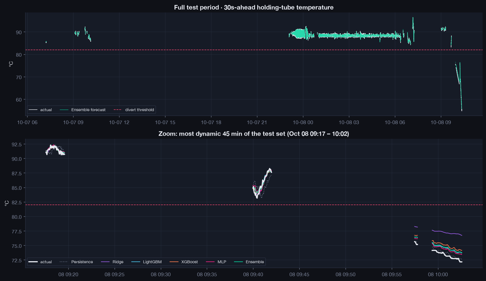
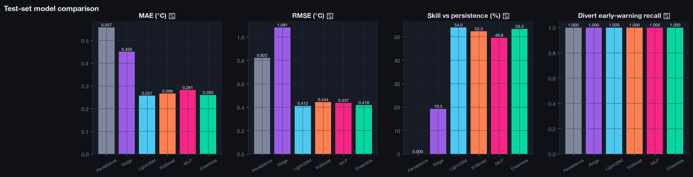
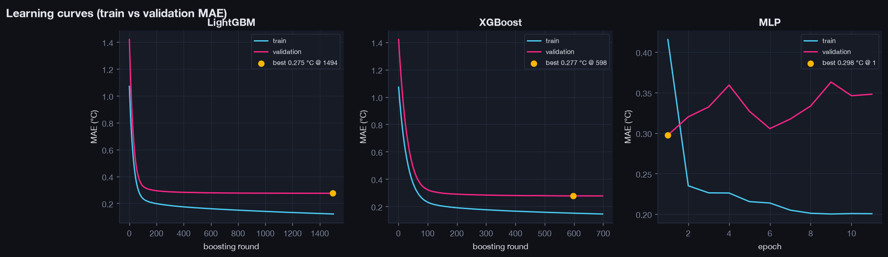
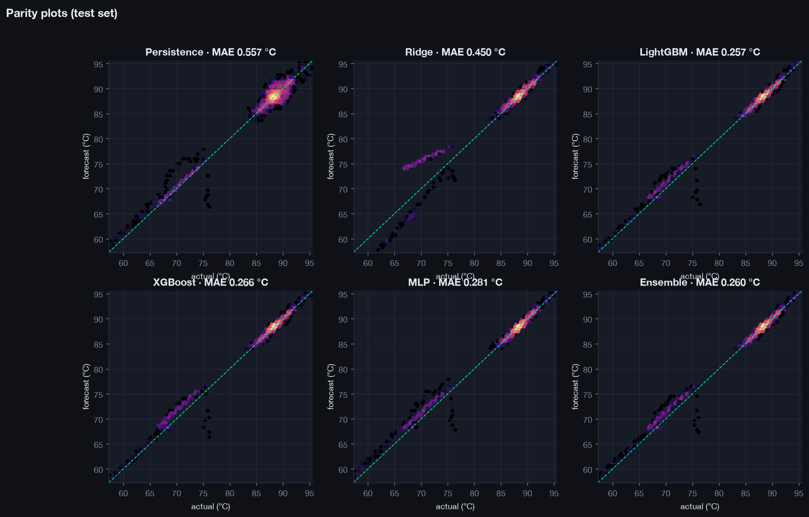
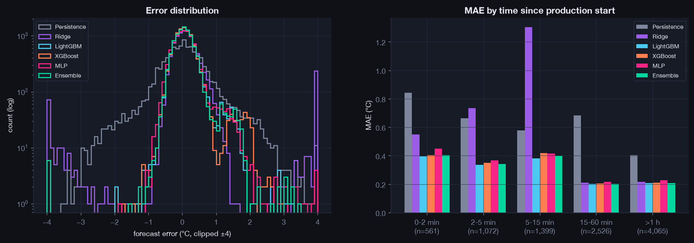
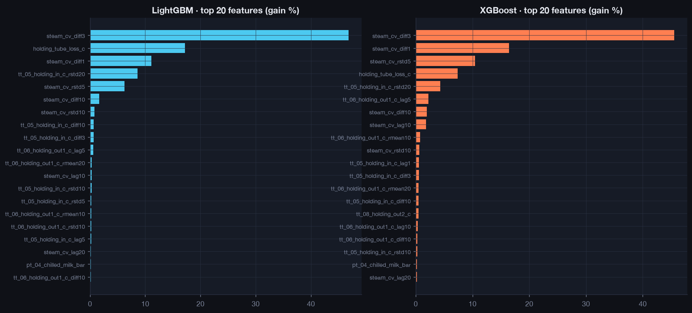
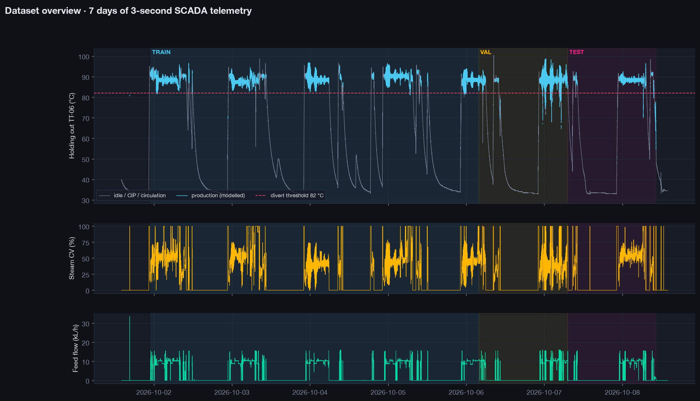

# HTST Pasteurizer Thermal Digital Twin 

> **High-frequency predictive thermal modeling and early warning system for continuous milk pasteurization.**

This repository implements a production-grade machine learning pipeline to forecast holding-tube outlet temperatures (`TT-06`) 30 seconds ahead across 200,000+ SCADA telemetry samples (~7 days of continuous production), predicting thermal deviations before they cause automated flow diversions.

---

## Pipeline Highlights

* **Thermal Lag Modeling**: Models temperature change ($\Delta T_{t+h} = T_{t+h} - T_t$) rather than static levels, capturing thermodynamic delay and steam valve dynamics.
* **Leakage-Free Production Segmentation**: Only valid production runs (flow $\ge 1000\text{ L/h}$) are modeled, with lag features bounded within continuous production runs.
* **Models Trained & Benchmarked**:
  * **Persistence Baseline** ($T_{t+h} = T_t$)
  * **Regularized Ridge Regression**
  * **LightGBM** (Hist gradient boosting)
  * **XGBoost** (Hist gradient boosting)
  * **Residual MLP** (PyTorch deep neural net with LayerNorm & GELU)
  * **Ensemble** (Averaged predictions)
* **Real-Time Visual Monitoring**: Displays console progress bars and auto-refreshes `outputs/live_training_progress.png` during training.
* **Diagnostic Visualizations & HTML Report**: Full suite of dark-themed plots (learning curves, parity hexbins, feature importances, error breakdown) and a standalone HTML dashboard.

---

## Benchmark Performance (Unseen Test Set)

| Model | MAE (°C) | RMSE (°C) | 95th %-ile Error (°C) | $R^2$ (Level) | $R^2$ ($\Delta$) | Skill vs Persistence | Divert Recall |
| :--- | :---: | :---: | :---: | :---: | :---: | :---: | :---: |
| **Persistence (Baseline)** | 0.557 | 0.822 | 1.830 | 0.965 | -0.002 | 0.0% | 100% |
| **Ridge Regression** | 0.450 | 1.081 | 1.048 | 0.939 | -0.735 | +19.3% | 100% |
| **Residual MLP (PyTorch)** | 0.281 | 0.437 | 0.774 | 0.990 | 0.717 | +49.6% | 100% |
| **XGBoost** | 0.266 | 0.444 | 0.681 | 0.990 | 0.708 | +52.3% | 100% |
| **LightGBM** | 0.257 | 0.412 | 0.688 | 0.991 | 0.749 | +54.0% | 100% |
| **Ensemble (Best)** | **0.260** | **0.418** | **0.683** | **0.991** | **0.741** | **+53.3%** | **100%** |

---

## Visual Diagnostics & Results

### 1. 30-Second Ahead Temperature Forecasts vs Ground Truth
*Upper panel shows the entire unseen test week; lower panel zooms into the most dynamic 45-minute operational transient:*


### 2. Model Accuracy & Benchmark Metrics
*Comparison across MAE, RMSE, Skill Score vs. persistence, and Divert Early-Warning safety recall:*


### 3. Training & Validation Learning Curves
*Loss trajectories with early-stopping convergence markers:*


### 4. Parity Density Hexbins
*Forecast vs actual alignment along the identity line (diagonal):*


### 5. Error Distribution & Operational Regimes
*Left: residual error distribution; Right: MAE grouped by time elapsed since production start (start-ups vs steady state):*


### 6. Feature Importance
*Top telemetry signals driving predictions in LightGBM and XGBoost:*


### 7. 7-Day SCADA Telemetry Overview
*Holding tube temperature, steam control valve position, and feed flow across the continuous 7-day dataset with train/val/test splits:*


---

## Quickstart

### 1. Installation
Ensure your environment has the required dependencies:
```bash
pip install -r requirements.txt
```

### 2. Train Models
Run the full training pipeline:
```bash
python train.py
```
* Options:
  * `--horizon 30`: Set forecast horizon in seconds (default: 30s).
  * `--models lightgbm xgboost mlp`: Select models to train.
  * `--quick`: Fast smoke run with fewer rounds/epochs.

While training is running, open `outputs/live_training_progress.png` or inspect `outputs/latest/report.html` once complete.

### 3. Generate Predictions on New CSV Logs
Run inference on any raw SCADA CSV export:
```bash
python predict.py --csv csv_files/pasteurizer_dataset41.csv
```
This produces:
* `<run>/predictions/pasteurizer_dataset41_predictions.csv` with predictions and boolean divert flags.
* `<run>/predictions/pasteurizer_dataset41_forecast.png` visualizing the forecast vs actual readings.

### 4. Launch Interactive Streamlit Dashboard
Launch the web interface for operators and engineers:
```bash
streamlit run app.py
```
Open `http://localhost:8501` to access:
* **Interactive Shift Telemetry**: Dual-axis zoomable Plotly charts with true temperatures, lookahead curves, and automatic divert risk flags.
* **What-If Steam Simulator**: Real-time slider controls simulating Steam CV and milk throughput perturbations with dynamic thermal response gauges.
* **Model Benchmark Viewer**: Embedded accuracy comparison tables and full resolution diagnostic figures.

---

## Repository Structure

```
├── configs/
│   └── default.yaml             # System configuration, features & hyperparameters
├── figures/                     # Publication-quality diagnostic graphs for README
├── src/
│   ├── data/
│   │   └── loader.py            # CSV deduplication, sanitization, and parquet caching
│   ├── features/
│   │   └── engineering.py       # Production segmentation, lag features & split logic
│   ├── models/
│   │   ├── tree_models.py       # Ridge, LightGBM, XGBoost with progress tracking
│   │   └── neural_models.py     # PyTorch Residual MLP architecture
│   ├── utils/
│   │   ├── metrics.py           # Regression metrics, skill scores & divert recall
│   │   ├── progress.py          # Real-time training dashboard & progress logger
│   │   └── report.py            # Standalone HTML report generator
│   └── visualization/
│       ├── plots.py             # Publication-quality diagnostic figures
│       └── style.py             # Cohesive dark theme styling
├── train.py                     # Training entry point
├── predict.py                   # Inference entry point
├── requirements.txt             # Project dependencies
└── outputs/                     # Generated models, plots, metrics and reports
```
